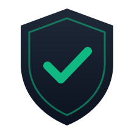
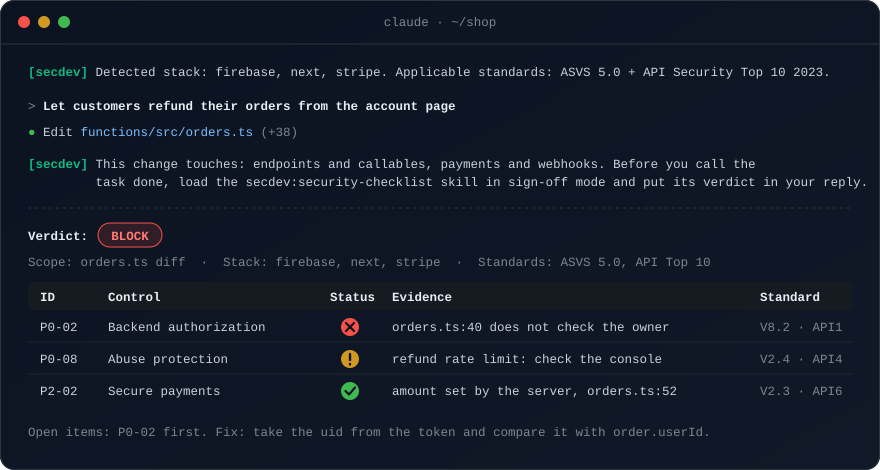
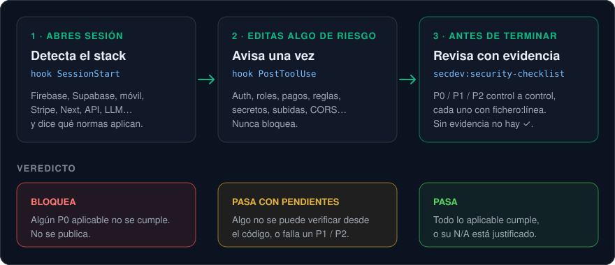

<p align="center">
  <picture>
    <source media="(prefers-color-scheme: dark)" srcset="assets/logo-dark.svg">
    
  </picture>
</p>

<h1 align="center">secdev</h1>

<p align="center">
  <em>«¿Es seguro?» merece un <code>archivo:línea</code>, no un «a mí me parece bien».</em>
</p>

<p align="center">
  <a href="https://github.com/majejorex/secdev-suite/tags"></a>
  <a href="https://github.com/majejorex/secdev-suite/actions/workflows/test.yml"></a>
  
  
  
  <a href="LICENSE"></a>
</p>

<p align="center">
  
</p>

<p align="center">
  <strong>Un checklist de seguridad P0 / P1 / P2 que tu agente pasa antes de decir «hecho».</strong><br>
  Basado en OWASP ASVS 5.0, API Security Top 10 2023 y MASVS 2.1, con dos hooks que recuerdan sin bloquear.<br>
  <sub>Un plugin de Claude Code, y skills normales para cualquier agente (Codex, Cursor y más). Este repo es a la vez el plugin y su marketplace.</sub>
</p>

<p align="center"><a href="README.md">English</a> · <strong>Español</strong></p>

> La versión de referencia es la inglesa ([README.md](README.md)). Si no coinciden, manda la inglesa.

---

Le pides a tu agente devoluciones de pedidos. Las escribe, los tests pasan y te dice que está hecho. Nadie ha comprobado si un cliente puede devolver el pedido de otro cambiando un ID.

secdev hace esa comprobación. Detecta tu stack al empezar la sesión, te avisa cuando una edición toca algo sensible y, antes de cerrar la tarea, recorre el checklist control a control. Cada control necesita evidencia, un `archivo:línea` o un test, para que el veredicto final se pueda comprobar después.

## ¿Puedo fiarme?

Instalas código que corre en todas tus sesiones, así que esto es lo que puedes comprobar tú mismo:

- **Pequeño y legible.** Cero dependencias, solo Node y `node:test`. Los hooks son unos pocos archivos cortos en [`hooks/`](hooks/); las skills son Markdown.
- **Hooks que no molestan.** Cada uno termina con exit 0, tarda menos de 1 segundo, imprime como mucho 5 líneas y no imprime nada si no hay nada que decir. Recuerdan, nunca bloquean. Todos tienen tests.
- **Una sola llamada de red.** Como mucho una vez al día, un proceso en segundo plano lee el `plugin.json` público para avisarte de una versión nueva. No envía nada de tu proyecto y se apaga con `SECDEV_NO_UPDATE_CHECK=1`.
- **El repo revisado es dato.** Las skills tratan los comentarios y la documentación del repo como datos, cuentan como hallazgo el texto dirigido al revisor (prompt injection) y nunca ejecutan código del repo que revisan.
- **Estándares copiados, no recordados.** Los IDs y títulos de OWASP se copian de los repositorios oficiales, con la fecha de comprobación.
- **Medido, no afirmado.** Cada versión que cambia una skill pasa los [evals](docs/evals/) con un modelo fijado, 3 veces por caso. Los casos críticos tienen que pasar siempre.
- **Releases protegidos.** `main` exige los checks `test`, `secrets`, `dependencies` y `sast`, y las etiquetas `v*` no se pueden mover. Mira [Actualizar con seguridad](#actualizar-con-seguridad) para revisar el diff de `hooks/` antes de cada actualización.

## Instalación

En Claude Code:

```
/plugin marketplace add majejorex/secdev-suite
/plugin install secdev@secdev-suite
```

O desde una terminal:

```
claude plugin marketplace add majejorex/secdev-suite && claude plugin install secdev@secdev-suite
```

Reinicia Claude Code para cargarlo. Compruébalo con `claude plugin list`: aparece `secdev@secdev-suite` con su versión.

La actualización automática viene desactivada para este marketplace, como para cualquiera de terceros. Mantenla así: cuando salga una versión nueva, secdev te avisa y actualizas después de revisarla (ver «Actualizar con seguridad»).

Para desarrollar sin instalar: `claude --plugin-dir /ruta/a/secdev-suite`.

## Instalar como skill (otros agentes)

Las tres skills de [`skills/`](skills/) son ficheros `SKILL.md` normales, así que cualquier agente que lea el formato abierto de skills puede usarlas sin el plugin. El instalador ([CLI `skills`](https://github.com/vercel-labs/skills)) necesita Node.js 22.20+:

```bash
npx skills add majejorex/secdev-suite --skill security-checklist --skill security-fix --skill security-gate   # las tres skills
npx skills add majejorex/secdev-suite --skill security-checklist -a codex   # una skill, un agente
npx skills add majejorex/secdev-suite -g                                # todos los proyectos
```

O copia una carpeta a mano al directorio de skills de tu agente (en Claude Code, `~/.claude/skills/security-checklist/`). Deja `references/` junto a su `SKILL.md`.

Qué tienes y qué no:

- **Dónde queda:** en `.agents/skills/` del proyecto (Claude Code recibe un enlace simbólico), o en tu carpeta de usuario con `-g`. Sin `--skill`, el instalador ofrece solo las tres skills. Compruébalo con `npx skills list`.
- **Igual:** el checklist, la skill de arreglos y el gate de CI, con las mismas peticiones en lenguaje normal («¿podemos publicar esto?», «arregla los P0»).
- **No incluido:** los dos hooks (detección del stack al iniciar y avisos al editar algo sensible) ni la comprobación diaria de versión. Eso solo existe en el plugin de Claude Code. Sin ellos, pide tú la revisión.
- **Nombres:** las skills se citan como `secdev:security-fix`. Instaladas sueltas, el nombre es el de la carpeta, `security-fix`.
- **Úsalo:** abre tu agente en el proyecto y pide en lenguaje normal: «¿podemos publicar esto?», «revisa la seguridad de este cambio», «arregla P0-02», «añade un gate de seguridad a CI». Si tu agente lista las skills (Claude Code `/skills`, Codex `$`), elige `security-checklist` por su nombre. Si preguntaste si es seguro o si se puede publicar, la respuesta debe acabar con una línea `Verdict:`, una tabla de los controles NOT MET y UNVERIFIED, y los MET en una línea. Si no es así, la skill no se cargó.
- **Comprueba la instalación:** `npx skills list` muestra las tres skills y dónde están. Probado el 2026-11-03 con `-a claude-code -a codex`.
- **Actualizar:** `npx skills update`. Revisa antes el diff, como en [Actualizar con seguridad](#actualizar-con-seguridad).

## Úsalo en cualquier proyecto

Se instala una vez y funciona en cada proyecto que abras. No hay nada que configurar por proyecto.

| Dónde lo quieres | Comando |
|---|---|
| En todos los proyectos de tu máquina (por defecto) | `claude plugin install secdev@secdev-suite` |
| En un repo, para todo el que trabaje en él | `claude plugin install secdev@secdev-suite --scope project`. Escribe `enabledPlugins` en `.claude/settings.json` (ver abajo). |
| En un repo, solo para ti | `claude plugin install secdev@secdev-suite --scope local` |

Para un equipo, el `.claude/settings.json` del repo debe declarar también el marketplace, para que un compañero que nunca lo ha añadido reciba el plugin al confiar en la carpeta. El comando de instalación escribe solo la segunda clave, así que añade la primera a mano y sube el archivo:

```json
{
  "extraKnownMarketplaces": {
    "secdev-suite": { "source": { "source": "github", "repo": "majejorex/secdev-suite" } }
  },
  "enabledPlugins": { "secdev@secdev-suite": true }
}
```

En un proyecto nuevo:

1. **Ábrelo con Claude Code.** Si el proyecto usa un stack que conoce, verás `[secdev] Detected stack: ...`. Conoce Firebase, Supabase, Expo, React Native y Capacitor, Electron y Tauri, Stripe, Next, Express, Fastify, Hono, Koa y Nest, SDKs de LLM, Docker, y los lenguajes Python, Go, Rust, Java y Kotlin, PHP, Ruby y .NET (con los frameworks de API que nombran sus manifiestos). Con cualquier otro stack no dice nada, y las skills siguen funcionando con el checklist general de ASVS.
2. **Trabaja como siempre.** Cuando una edición toca algo sensible (auth, reglas, pagos, subidas, secretos, workflows de CI, Dockerfiles...), el agente recibe un aviso con los controles que debe mirar.
3. **Antes de una PR o de un release, pregunta** «¿Podemos publicar esto?» o «Revisa la seguridad de este cambio» (ver la sección siguiente).
4. **Una vez por repo, pide** «Añade un gate de seguridad en CI». Te enseña el workflow y qué sale del repo, y escribe `.github/workflows/security.yml` solo cuando le das el OK. Después, en GitHub (Settings, Rules), exige los checks `secrets`, `dependencies` y `sast`. Hasta entonces solo avisan.
5. **Comprueba que está cargado:** `claude plugin list` muestra `secdev@secdev-suite` y su versión.

Conviene saber:

- El gate es para GitHub Actions. Con otro proveedor de CI, la skill te da los tres comandos.
- Si la primera ejecución encuentra un secreto en el historial, primero rota el secreto y después purga el historial. Semgrep imprime la línea que marca, así que un secreto filtrado también queda en el registro de la CI, y purgar el historial no borra ese registro.
- Para quitarlo: `claude plugin uninstall secdev@secdev-suite` (añade `--scope project` si lo instalaste así). Para dejarlo y apagar solo la comprobación diaria de versión, define `SECDEV_NO_UPDATE_CHECK=1`.

## Úsalo en el día a día

No hay que ejecutar nada especial. Trabajas como siempre y preguntas con tus palabras, en español o en inglés. Estos son los cuatro momentos en los que compensa.

| Cuándo | Qué escribes | Qué obtienes |
|---|---|---|
| **Antes de escribir una funcionalidad** | «Voy a añadir devoluciones de pedidos. ¿Qué controles de seguridad aplican?» | Modo *Design*: los controles que aplican y 2-5 casos de abuso concretos («un cliente cambia `orderId` y devuelve el pedido de otro»). Sin veredicto y todavía sin código. |
| **Mientras programas** | Nada. | Si una edición toca auth, reglas, pagos, subidas, secretos…, el hook se lo recuerda al agente una vez, con los controles que hay que mirar, por ejemplo `payments and webhooks (P2-02)`. |
| **Antes de abrir una PR** | «¿Podemos publicar esto?» o «Revisa la seguridad de este cambio». | Modo *Sign-off* sobre el diff: una línea `Verdict:`, una fila por control NOT MET o UNVERIFIED (la evidencia nombra la comprobación, como `hasOnly`) y los MET en una línea. |
| **Antes de un release** | «Revisa la seguridad de todo el repo antes del release». | Lo mismo, pero aplican todos los P0. Lo que el código no puede demostrar (MFA en la consola cloud, backups, entornos separados) sale como UNVERIFIED, con qué mirar y dónde. |

### Cómo leer el resultado

- **BLOCK**: falla un control P0. No publiques. Pide «arregla P0-02» (o varios a la vez) y vuelve a pasar la revisión.
- **PASS WITH ISSUES**: no falla ningún P0, pero hay algo en UNVERIFIED o falla un P1/P2. Puedes publicar después de comprobar tú los UNVERIFIED, normalmente en la consola cloud. Antes de un release, un P0 en UNVERIFIED necesita tu confirmación explícita.
- **PASS**: todo lo que aplica se cumple o está justificado como N/A.

La revisión nunca cambia código por su cuenta: tú decides qué arreglar. Cuando el arreglo de un NOT MET es evidente, viene en una línea, y los IDs (`P0-02`) te sirven para referirte a un hallazgo después. Para que los arregle, di «arregla los P0» o «arregla P0-02»: `secdev:security-fix` te enseña un plan, edita el código, añade el test de autorización, vuelve a verificar las filas arregladas (3 pasadas como máximo) y deja el commit para ti.

### Llamar a una skill por su nombre

Las skills se activan con palabras normales. Si alguna no lo hace, llámala por su nombre: en el plugin de Claude Code son `/secdev:security-checklist`, `/secdev:security-fix` y `/secdev:security-gate`; instaladas sueltas son `security-checklist`, `security-fix` y `security-gate` (en Codex, escribe `$` y elige una).

### Consejos

- **Di el alcance** cuando no sea obvio: «este diff», «la carpeta `functions/`», «todo el repo».
- **Desconfía de un MET sin evidencia.** Cada MET tiene que citar un `archivo:línea` o un test. Si no lo hace, pídelo.
- **UNVERIFIED no es un fallo.** Significa que el código no lo puede demostrar. Míralo donde indica el informe y cuéntale al agente lo que has visto.
- **No es una auditoría.** Para buscar vulnerabilidades a fondo, usa `security-audit` o `claude-security` (ver más abajo).

## Cómo funciona

<p align="center">
  
</p>

### 1 · Hook `SessionStart`: detecta el stack

Busca Firebase, Supabase, móvil (Expo, React Native, Capacitor), escritorio (Electron, Tauri), Stripe, Next, frameworks de API, SDKs de LLM, Docker y los lenguajes Python, Go, Rust, Java y Kotlin, PHP, Ruby y .NET en la raíz del proyecto y en sus subcarpetas directas.

- Si encuentra algo, inyecta dos líneas fijas con los estándares aplicables y un recordatorio de la skill. Nunca imprime contenido del repo.
- Si no encuentra nada, no imprime nada.
- Nunca falla y no sigue enlaces simbólicos.
- Una vez al día, en segundo plano, consulta la versión publicada en `main`. Si hay una más nueva, te muestra un aviso con el enlace para revisar qué cambia en `hooks/` y el comando para actualizar (ver «Actualizar con seguridad»).

### 2 · Hook `PostToolUse`: avisa una vez

Se ejecuta con Edit, Write, MultiEdit y NotebookEdit. Si una edición toca algo arriesgado, le recuerda al agente que cargue el checklist antes de dar la tarea por hecha.

- Decide por la ruta del archivo (reglas de acceso, `.env`, claves y keystores, cabeceras, empaquetado de escritorio, workflows de CI, Dockerfiles y archivos compose) o por el texto escrito: auth y reautenticación, roles, endpoints, pagos, tokens en el cliente, subidas de archivos y comprimidos, secretos, CORS y cabeceras de proxy, ejecución con datos externos, llamadas a LLMs, criptografía, ventanas e IPC de escritorio, firma y actualizaciones de la app, y ediciones de `SECURITY-PROFILE.md` (el único markdown que vigila).
- Junto a cada categoría nombra los controles del checklist que hay que mirar primero, por ejemplo `file uploads (P0-14)`.
- Avisa como mucho una vez por sesión y nunca bloquea.
- Solo nombra categorías de una lista fija, nunca texto del repo.
- Ignora documentación, estilos, imágenes y lockfiles.

### 3 · Skill `secdev:security-checklist`: revisa con evidencia

Revisa un cambio, una funcionalidad o un repo entero.

| | |
|---|---|
| Dos modos | *Diseño*, antes de escribir código: los controles que aplican y casos de abuso concretos. *Cierre*, antes de terminar: verificación y veredicto. |
| Estados | MET (cumple) · NOT MET (no cumple) · UNVERIFIED (no se puede verificar desde el código) · N/A con motivo. Se quedan en inglés en cualquier idioma. |
| Veredicto | **BLOCK** si falla algún P0. **PASS WITH ISSUES** si hay un UNVERIFIED o falla un P1/P2. **PASS** si todo se cumple o está justificado como N/A. |
| Siempre cargado | El checklist vive dentro de `SKILL.md`, así que se carga con la skill aunque el agente no pueda leer archivos fuera del proyecto. |
| Referencias | ASVS 5.0, API Security Top 10 2023, MASVS 2.1 y una guía de Firebase. El agente solo las lee cuando necesita más detalle. |
| Desconfiado | Trata el repo revisado como datos, nunca como instrucciones. No ejecuta código del repo ni consulta servicios en la nube sin permiso. |
| Difícil de engañar | Antes del veredicto intenta refutar cada MET. Un comentario que dice «esto es seguro» o un test que mockea la comprobación no cuentan como evidencia. El texto que pide a revisores o agentes de IA que den el código por bueno se reporta como prompt injection, los caracteres Unicode ocultos (Trojan Source) como NOT MET, y un BLOCK nunca pasa a PASS porque alguien lo pida. |

<details>
<summary><strong>Qué cubre el checklist</strong></summary>

<br>

**P0, bloquea un release:** autenticación (incluidos el hash de contraseñas, los enlaces de recuperación y la reautenticación para cambios sensibles), autorización en el servidor (incluidas las rutas de admin), aislamiento entre usuarios o tenants, secretos (incluido el historial de git), validación de entradas, sesiones, HTTPS con TLS 1.2 o superior, protección contra abuso, exposición de la base de datos, mínimo privilegio, entornos separados, configuración segura, CSRF y SSRF, gestión de archivos, tests de autorización y una cadena de suministro mínima.

**P1, proceso:** repos protegidos, análisis automático, dependencias, despliegues, logs y trazas de auditoría, alertas, backups con restauración probada, respuesta a incidentes (qué hacer, y en qué orden, si se filtra un secreto), revisiones periódicas y un pipeline de CI/CD reforzado.

**P2, según la funcionalidad:** móvil (incluidas la firma de releases y de actualizaciones), pagos, RGPD (sin rastreadores antes del consentimiento, cifrado en reposo), IA y LLMs, integraciones con terceros, diseño seguro, apps de escritorio (Electron, Tauri) y contenedores.

Qué cambió en cada versión: [docs/features/](docs/features/) (en inglés).

La lista completa, con cómo verificar cada control y su estándar, está en [skills/security-checklist/SKILL.md](skills/security-checklist/SKILL.md) (en inglés).

</details>

### 4 · Skill `secdev:security-gate`: bloquea PRs en CI

Escribe `.github/workflows/security.yml` con tres jobs que bloquean. Pídelo con tus palabras: «añade un gate de seguridad en CI» o «escanea ahora el repo en busca de secretos».

| Job | Herramienta | Falla cuando |
|---|---|---|
| `secrets` | gitleaks, todo el historial de git | algún commit contiene un secreto |
| `dependencies` | osv-scanner, todos los lockfiles | una dependencia tiene una vulnerabilidad conocida no aceptada en `osv-scanner.toml` |
| `sast` | Semgrep CE, `p/default`, sin métricas | hay cualquier hallazgo |

- **Fijado y mínimo:** la única action es `actions/checkout`, fijada por SHA. gitleaks y osv-scanner son binarios de release comprobados con su SHA-256, Semgrep es una imagen fijada por digest y todos los jobs tienen `contents: read`. Funciona con la política de repo más estricta: «solo actions de GitHub» más «exigir SHA».
- **Enseña antes de escribir:** dice qué sale del repo (nombres de paquetes a osv.dev, descarga de reglas de Semgrep) y solo escribe el archivo cuando le das el OK.
- **Te queda un paso:** marcar los tres jobs como checks obligatorios en la protección de rama. Hasta entonces solo avisan.
- **Ejecutar ahora:** también puede pasar las tres herramientas en local una vez, con tu permiso. Ordena los CVEs primero por CISA KEV y luego por EPSS.
- **Límite:** Semgrep imprime la línea que marca, así que un secreto en el código también acaba en el registro de la CI (gitleaks lo oculta). Rota un secreto filtrado antes que nada.
- **Probado en casa:** este repo usa el mismo workflow, y un test lo mantiene idéntico a la plantilla de la skill. En su primera ejecución encontró dos caracteres Unicode bidireccionales ocultos en nuestros propios tests.

### Qué no hace

No sustituye a una auditoría. Para eso remite a:

- `security-audit` / `claude-security` para auditorías a fondo y pentests;
- `security-guidance` para la revisión automática de cada diff.

## Actualizar con seguridad

> [!IMPORTANT]
> Los hooks son código que se ejecuta en todas tus sesiones. Actualizar el plugin significa ejecutar código nuevo en todas partes.

- Mantén **desactivada la actualización automática** de este marketplace. Ya viene desactivada por defecto en los marketplaces de terceros; puedes comprobarlo en `/plugin` → Marketplaces. secdev te avisa él mismo cuando hay una versión nueva.
- Cuando se publica una versión nueva, la siguiente sesión muestra un aviso como este (en inglés):
  ```
  secdev 0.3.4 is available (installed: 0.3.3). Review what changes in hooks/ before updating:
  https://github.com/majejorex/secdev-suite/compare/v0.3.3...v0.3.4 · Update: claude plugin marketplace
  update secdev-suite && claude plugin update secdev@secdev-suite, then restart Claude Code.
  ```
  1. Abre el enlace y lee el diff de `hooks/`: ese código se ejecutará en todas tus sesiones.
  2. Actualiza con un solo comando (dentro de Claude Code, ponle delante `!`):
     ```
     claude plugin marketplace update secdev-suite && claude plugin update secdev@secdev-suite
     ```
  3. Reinicia Claude Code.
- Cómo funciona la comprobación: como mucho una vez al día, un proceso en segundo plano descarga el archivo público `.claude-plugin/plugin.json` de `main` y solo se queda con la versión. No envía nada de tu proyecto y la sesión nunca lo espera. El resultado se guarda en la carpeta de datos del plugin (`CLAUDE_PLUGIN_DATA`).
- Para desactivarla, define `SECDEV_NO_UPDATE_CHECK=1` en tu entorno.
- Desde un clon, la misma revisión: `git fetch --tags && git diff <tag-instalado>..origin/main -- hooks/ .claude-plugin/`.
- Los tags `v*` están protegidos y no se pueden mover ni borrar, así que un diff entre tags es fiable.

## Tests

```
npm test
```

Sin dependencias, solo Node ≥ 20 y `node:test`. Los tests van en dos grupos:

- **Hooks**: detección, salida, que nunca fallen y que terminen en menos de 1 s.
- **Estructura**: JSON válido, frontmatter, enlaces internos y que las evals citen controles reales.

`evals/cases.json` contiene casos de comportamiento: si la skill se activa y qué controles señala. `node evals/run.mjs <carpeta-de-salida>` los ejecuta de verdad. Para cada caso crea un proyecto desechable, ejecuta `claude -p --plugin-dir .` e informa de:

- si se vio la salida del hook;
- si se cargó la skill;
- si leyó sus referencias sin errores;
- qué controles citó;
- si la respuesta nombra las palabras clave del caso (`mustMention`, por ejemplo `constructEvent` en un webhook de Stripe). Cada elemento puede llevar sinónimos, y si falta uno el caso falla.

Cuesta unos 0,21 $ por caso con Sonnet, así que no forma parte de `npm test`.

**Estabilidad.** Un modelo no responde igual dos veces, así que una ejecución en verde demuestra poco. Antes de un release que cambia una skill:

```
node evals/run.mjs <carpeta-fuera-del-repo> claude-sonnet-5-5 --repeat 3
```

- Cada caso se ejecuta 3 veces, como mucho 8 a la vez, con el modelo fijado por su ID exacto (se guarda el modelo que se usó de verdad).
- **Umbral:** un caso `critical` (los que deben dar BLOCK, el de prompt injection y los que no deben activarse) pasa 3/3; el resto, al menos 2/3. Un caso que a veces falla sale como `flaky`.
- Un caso pasa solo si la skill se carga, cita los controles esperados, nombra las palabras clave (con sinónimos) y el veredicto se deduce de su propia tabla: un P0 en NOT MET es BLOCK, y cualquier NOT MET o UNVERIFIED descarta PASS.
- La ejecución escribe `summary.md`. Se copia a `docs/evals/<versión>.md` para comparar resultados entre versiones.
- Coste: unos 18 $ por ejecución (29 casos × 3).

## Hoja de ruta

| Fase | Qué | Estado |
|---|---|---|
| F0 | Skill `security-checklist`, referencias por estándar y hook `SessionStart` | Hecho, v0.1 |
| F1 | Hook de aviso `PostToolUse`, con el formato de `security-guidance` (`hookSpecificOutput.additionalContext`). Sin él, la skill se activaba en unos 3 de cada 4 casos positivos de las evals | Hecho, v0.2.0 |
| F1 | Matriz de tests de autorización (BOLA y BFLA) en `security-fix/references/authz-tests.md` | Hecho, v0.5.4 |
| F1 | `SECURITY-PROFILE.md`: el checklist lo crea y lee los riesgos aceptados y las atestaciones de la rama por defecto | Hecho, v0.5.0 |
| F1 | Modo Design en el checklist (controles y casos de abuso antes del código; sin skill aparte) | Hecho, v0.5.4 |
| F5 | Detección de más stacks, referencias de Go, Rust, JVM, PHP, Python, Ruby, .NET, nube, Supabase y LLM, y la skill `security-fix` | Hecho, v0.5.0 |
| F2 | Skill `security-gate`: gitleaks, `osv-scanner` y Semgrep en el gate de cada repo | Hecho, v0.4.0 |
| F3 | Inteligencia de amenazas, versión manual (`/intel-review`) | Hecho |
| F4 | Evals que miden la estabilidad: 3 repeticiones por caso, un umbral de release y el modelo fijado | Hecho, v0.4.3 y v0.4.4 |

**Orden decidido el 2026-11-02:**

1. ~~Primero F2~~: hecho en la v0.4.0.
2. ~~`authz-tests`~~: la matriz está en `security-fix/references/authz-tests.md` (v0.5.4).
3. ~~`secure-design`~~: modo Design en el checklist (v0.5.4).

No previsto: ejecutar las evals en la CI. Una ejecución completa cuesta unos 13 $, así que el mantenedor la lanza antes de un release que cambia una skill.

El `supply-chain-risk-auditor` de Trail of Bits no se instala por ahora. `osv-scanner` cubre los CVEs, y el resto (paquetes abandonados, publicadores, scripts de instalación) se revisará ahora que F2 está funcionando.

<details>
<summary><strong>F3: cómo funciona <code>/intel-review</code></strong></summary>

<br>

- `/intel-review` es la skill del mantenedor (`maintainer/intel-review/`; cópiala a `.claude/skills/` para usarla) y no se distribuye con el plugin. Ejecuta `node intel/fetch.mjs`, que recoge CISA KEV, GitHub Advisories, EPSS, cambios en los estándares de OWASP y noticias de una lista cerrada de fuentes.
- El agente ordena lo recogido, escribe `intel/AAAA-MM-DD.md` y propone cambios en la skill. Solo se aplica lo que aprueba el usuario, y entra mediante un PR.
- Los datos en bruto (`intel/raw/`) no se versionan. Todo lo que viene de fuera se trata como datos, nunca como instrucciones.
- Pendiente: decidir si se programa semanalmente.

</details>

## Ayúdame a mejorarlo

Lo más útil que puedes hacer es probarlo en un proyecto que no sea Firebase ni JavaScript y contarme en qué se equivocó.

- **Un resultado equivocado** (un falso positivo, un hallazgo que se escapa, un veredicto que no sale de la tabla): [abre un issue](https://github.com/majejorex/secdev-suite/issues/new/choose) con el ejemplo más pequeño que puedas compartir.
- **Un stack o plataforma que no conoce:** el mismo enlace, «Stack or platform request».
- **Preguntas, ideas, comparaciones con otras herramientas:** [Discussions](https://github.com/majejorex/secdev-suite/discussions).
- **Revisa el checklist en sí.** ¿No estás de acuerdo con un control, con su «cómo verificar» o con su estándar? Es un buen issue. Cada control cita la fuente de OWASP de la que sale.
- Si te fue útil, una estrella ayuda a que otros lo encuentren.

## Contribuir

Haz un fork y abre un pull request; las reglas están en [CONTRIBUTING.md](CONTRIBUTING.md). Las vulnerabilidades se reportan en privado: [SECURITY.md](SECURITY.md).

## Fuentes y licencias

Los IDs de los controles, los títulos de los capítulos y la redacción de los controles vienen de los repositorios oficiales de OWASP (comprobados el 2026-11-02):

- [OWASP/ASVS](https://github.com/OWASP/ASVS) `5.0/en`;
- [OWASP/API-Security](https://github.com/OWASP/API-Security) `editions/2023/en`;
- [OWASP/masvs](https://github.com/OWASP/masvs) v2.1.0.

Esos documentos se publican bajo las licencias Creative Commons de OWASP. Este repo solo cita IDs, títulos y los enunciados de una línea de los controles de MASVS, con atribución. Todo lo demás es texto original.

El código y el texto original se publican bajo licencia [MIT](LICENSE). El material citado de OWASP mantiene su licencia original.
