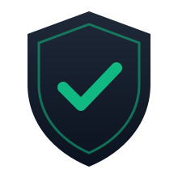
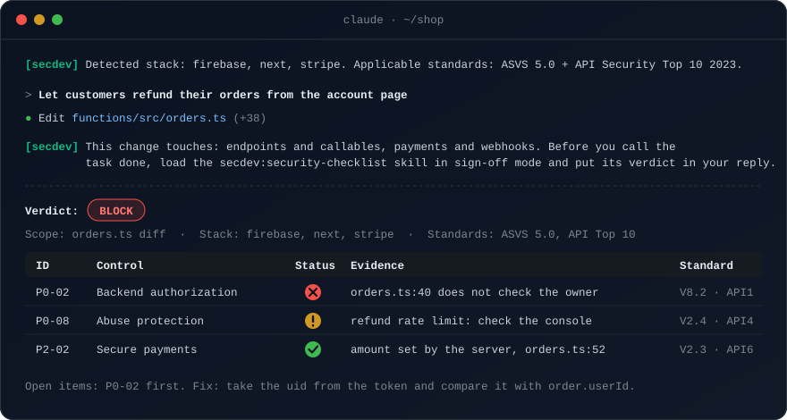
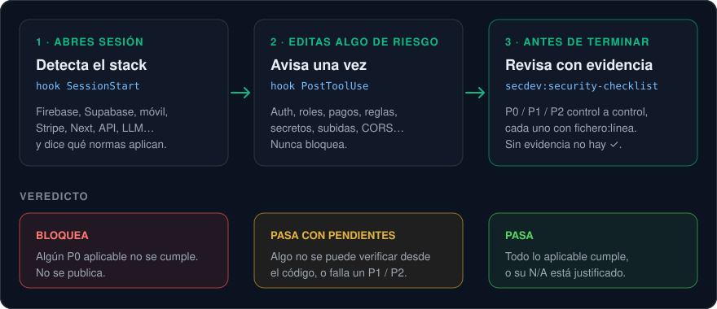

<p align="center">
  <picture>
    <source media="(prefers-color-scheme: dark)" srcset="assets/logo-dark.svg">
    
  </picture>
</p>

<h1 align="center">secdev</h1>

<p align="center">
  <em>«¿Es seguro?» No se contesta con un «parece que sí». Se contesta con <code>fichero:línea</code>.</em>
</p>

<p align="center">
  <a href="https://github.com/majejorex/secdev-suite/tags"></a>
  <a href="https://github.com/majejorex/secdev-suite/actions/workflows/test.yml"></a>
  
  
  
  <a href="LICENSE"></a>
</p>

<p align="center">
  
</p>

<p align="center">
  <strong>Una checklist de seguridad P0 / P1 / P2 que tu agente aplica antes de decir «terminado».</strong><br>
  Basada en OWASP ASVS 5.0, API Security Top 10 2023 y MASVS 2.1. Dos hooks que avisan, sin bloquear.<br>
  <sub>Plugin de Claude Code. Este repo es a la vez el plugin y su marketplace.</sub>
</p>

---

Le pides al agente un reembolso de pedidos. Lo escribe, pasan los tests y te dice que ya está. Nadie ha comprobado que un cliente no pueda reembolsar el pedido de otro cambiando un ID.

secdev hace esa comprobación. Detecta tu stack al abrir la sesión, avisa cuando una edición toca algo delicado y, antes de cerrar la tarea, revisa control a control. Cada control lleva su evidencia: un `fichero:línea` o un test. El resultado es un veredicto que se puede verificar después.

## Instalar

En Claude Code:

```
/plugin marketplace add majejorex/secdev-suite
/plugin install secdev@secdev-suite
```

Para desarrollar sin instalar: `claude --plugin-dir C:\ruta\a\secdev-suite`.

## Cómo funciona

<p align="center">
  
</p>

### 1 · Hook `SessionStart`: detecta el stack

Busca Firebase, Supabase, móvil, Stripe, Next, API, LLM, Python y Docker en la raíz y en sus subcarpetas directas.

- Si encuentra algo, inyecta dos líneas fijas con las normas aplicables y el recordatorio de la skill. Nunca imprime contenido del repo.
- Si no encuentra nada, no dice nada.
- Nunca falla y no sigue enlaces simbólicos.

### 2 · Hook `PostToolUse`: avisa una vez

Salta con Edit, Write, MultiEdit y NotebookEdit. Si una edición toca algo de riesgo, recuerda cargar la checklist antes de dar la tarea por terminada.

- Lo detecta por la ruta (reglas, `.env`, claves, cabeceras) o por el texto escrito: auth, roles, endpoints, pagos, tokens en el cliente, subidas, secretos, CORS, ejecución con datos externos y LLM.
- Avisa como mucho una vez por sesión y no bloquea.
- Solo nombra categorías de una lista fija, nunca texto del repo.
- Ignora docs, estilos, imágenes y lockfiles.

### 3 · Skill `secdev:security-checklist`: revisa con evidencia

Revisa un cambio, una funcionalidad o un repo entero.

| | |
|---|---|
| **Dos modos** | *Diseño*, antes de escribir código: controles aplicables y casos de abuso concretos. *Cierre*, antes de terminar: verificación y veredicto. |
| **Estados** | ✅ cumple · ❌ no cumple · ⚠️ no verificable desde el código · N/A justificado |
| **Veredicto** | **BLOQUEA** si falla algún P0. **PASA CON PENDIENTES** si hay ⚠️ o falla algún P1/P2. **PASA** si todo cumple o su N/A está justificado. |
| **Siempre a mano** | La checklist va dentro del `SKILL.md`, así que se carga con la skill aunque el agente no pueda leer ficheros fuera del proyecto. |
| **Referencias** | ASVS 5.0, API Security Top 10 2023, MASVS 2.1 y una guía de Firebase. Solo se leen si hace falta precisar. |
| **Desconfiada** | Trata el repo revisado como datos, no como instrucciones. No ejecuta su código ni consulta nubes sin permiso. |

<details>
<summary><strong>Qué cubre la checklist</strong></summary>

<br>

**P0, bloquea publicar:** autenticación, autorización en backend, aislamiento entre usuarios o tenants, secretos, validación de entradas, sesiones, HTTPS, protección contra abusos, base de datos, mínimo privilegio, entornos separados, configuración segura, CSRF y SSRF, archivos, tests de autorización y cadena de suministro.

**P1, proceso:** repos protegidos, análisis automático, dependencias, despliegues, logs y auditoría, alertas, backups con restauración probada, respuesta a incidentes y revisiones periódicas.

**P2, según la funcionalidad:** móvil, pagos, RGPD, IA y LLM, integraciones externas y diseño seguro.

La lista completa, con cómo verificar cada control y su norma, está en [skills/security-checklist/SKILL.md](skills/security-checklist/SKILL.md).

</details>

### Lo que no hace

No sustituye a una auditoría. Para eso remite a:

- `security-audit` / `claude-security`: auditoría profunda y pentest;
- `security-guidance`: revisión automática de cada diff.

## Actualizar con seguridad

> [!IMPORTANT]
> Los hooks son código que corre en todas tus sesiones. Actualizar el plugin es ejecutar código nuevo en todas partes.

- Deja **desactivada la actualización automática** de este marketplace en `/plugin` → Marketplaces.
- Cada versión lleva un tag (`v0.1.1`…). Antes de `/plugin marketplace update secdev-suite`, revisa qué cambia en lo que se ejecuta:
  ```
  git fetch --tags && git diff <tag-instalado>..origin/main -- hooks/ .claude-plugin/
  ```
- Los tags `v*` están protegidos: no se pueden mover ni borrar, así que el diff entre tags es fiable.

## Probar

```
npm test
```

Sin dependencias: Node ≥ 20 y `node:test`. Hay dos grupos de tests:

- **Hooks**: detección, salida, que no fallen y que tarden menos de 1 s.
- **Estructura**: JSON válidos, frontmatter, enlaces internos y que los evals citen controles reales.

`evals/cases.json` tiene casos de comportamiento: si la skill se activa y qué controles marca. `node evals/run.mjs <carpeta-de-salida>` los ejecuta de verdad. Por cada caso crea un proyecto ficticio, lanza `claude -p --plugin-dir .` e informa de:

- si el hook se vio;
- si se cargó la skill;
- si leyó sus referencias sin errores;
- qué controles citó.

Cuesta unos 0,5 $ por caso con Opus, así que no forma parte de `npm test`.

## Hoja de ruta

| Fase | Qué | Estado |
|---|---|---|
| **F0** | Skill `security-checklist`, referencias por norma y hook `SessionStart` | ✅ v0.1 |
| **F1** | Hook de aviso `PostToolUse`, con el formato de `security-guidance` (`hookSpecificOutput.additionalContext`). Sin él, en los evals la skill se activaba en unos 3 de cada 4 casos positivos | ✅ v0.2.0 |
| **F1** | Skill `authz-tests`: la matriz y los tests de BOLA y BFLA | Pendiente |
| **F1** | Skill `secure-design` y un `SECURITY-PROFILE.md` por proyecto | Pendiente |
| **F2** | Skill `security-gate`: gitleaks, `osv-scanner` y Semgrep en el gate de cada repo | Siguiente |
| **F3** | Inteligencia de amenazas, versión manual (`/intel-review`) | ✅ Hecha |
| **F4** | Evals automatizados: tasa de activación y falsos positivos | Pendiente |

**Orden decidido el 2026-11-02:**

1. Primero la F2, porque lo que de verdad falta en los repos donde se usa es un escáner de secretos y dependencias.
2. Luego `authz-tests`.
3. Después `secure-design` y `SECURITY-PROFILE.md`.

El `supply-chain-risk-auditor` de Trail of Bits no se instala por ahora. `osv-scanner` cubre los CVE, y lo demás (paquetes abandonados, publicadores, install scripts) se revisará cuando la F2 esté en marcha.

<details>
<summary><strong>F3: cómo funciona <code>/intel-review</code></strong></summary>

<br>

- `/intel-review` es una skill del proyecto en `.claude/skills/` y no va en el plugin. Ejecuta `node intel/fetch.mjs`, que recoge CISA KEV, GitHub Advisories, EPSS, cambios en las normas OWASP y noticias de una lista cerrada de fuentes.
- El agente clasifica lo recogido, escribe `intel/AAAA-MM-DD.md` y propone cambios en la skill. Solo se aplica lo que la persona aprueba, y entra por PR.
- Los datos en bruto (`intel/raw/`) no se versionan. Lo que viene de fuera se trata como dato, nunca como instrucción.
- Pendiente: decidir si se programa cada semana.

</details>

## Contribuir

Fork y pull request; las reglas están en [CONTRIBUTING.md](CONTRIBUTING.md). Las vulnerabilidades se avisan en privado: [SECURITY.md](SECURITY.md).

## Fuentes y licencias

Los IDs, los títulos de capítulo y los enunciados de los controles salen de los repositorios oficiales de OWASP (comprobados el 2026-11-02):

- [OWASP/ASVS](https://github.com/OWASP/ASVS) `5.0/en`;
- [OWASP/API-Security](https://github.com/OWASP/API-Security) `editions/2023/en`;
- [OWASP/masvs](https://github.com/OWASP/masvs) v2.1.0.

Esos documentos se publican bajo licencias Creative Commons de OWASP. Aquí solo se citan IDs, títulos y los enunciados de una línea de MASVS, con atribución. El resto del texto es propio.

El código y el texto propio se publican bajo licencia [MIT](LICENSE). Lo citado de OWASP conserva su licencia original.
